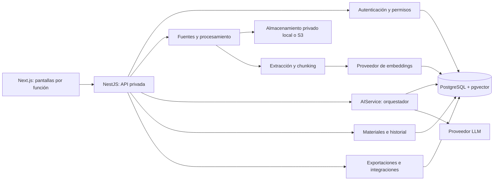
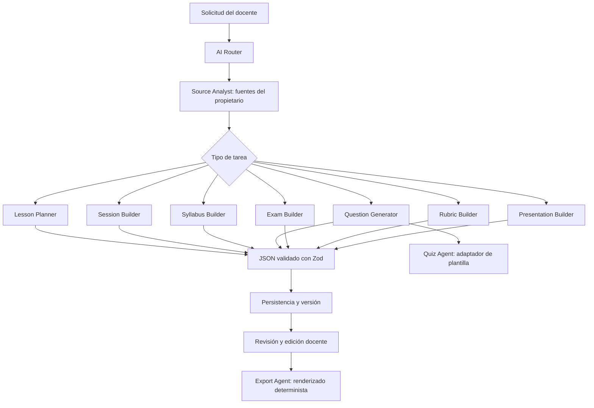
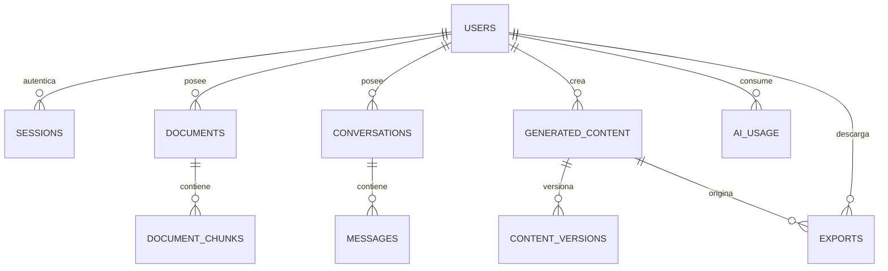

# Arquitectura del MVP

## Stack y separación

Monolito modular: Next.js 16 + React 19 + TypeScript en frontend; NestJS 11 en backend; PostgreSQL y pgvector; Gemini para generación y embeddings; almacenamiento local privado en desarrollo o S3/MinIO/R2 en producción. PGlite permite usar el mismo motor SQL y pgvector en desarrollo sin un daemon PostgreSQL.



Las pantallas solo llaman al servicio API; nunca manejan claves de IA. La API valida identidad y propiedad en cada lectura y escritura, además del aislamiento de fuentes antes de la búsqueda vectorial.

## Organización de carpetas

```text
frontend/src/
  app/                      rutas existentes, login, registro y shell
  components/               sidebar, sesión y avisos
  features/
    sources/                fuentes y selección de contexto
    chat/                   conversación y memoria
    materials/              catálogo, generación, edición y vistas
    history/                biblioteca y exportaciones
    dashboard/              métricas reales
    integrations/           importación de quizzes
    settings/               perfil y consumo
  services/api.ts           HTTP, renovación de sesión y descargas
backend/src/
  auth/                     sesiones y guard
  documents/                almacenamiento, extracción, web y worker
  ai/                       proveedor, contratos y orquestación
  content/                  CRUD, versiones, bancos y dashboard
  exports/                  DOCX/PDF/PPTX y adaptadores XLSX
  database/                 acceso SQL y esquema
  common/                   validación
```

Cada tipo de contenido educativo comparte persistencia, edición y permisos, con un contrato específico. Así se evitan servicios y tablas duplicados para cada pantalla.

## Agentes y resultados

Los agentes son políticas especializadas ejecutadas por `AIService`, no procesos externos ni un único prompt gigante. El router reconoce intenciones de generación explícitas; el analista de fuentes controla recuperación y límites. Las consultas explicativas siguen el chat normal.



Una solicitud de clase y presentación ejecuta primero el planificador, guarda el resultado y pasa ese material al constructor de presentaciones. El encadenamiento se limita a tres tareas; también se puede transformar un material desde los botones de revisión. El docente no tiene que elegir un agente técnico.

`contracts.ts` define schemas de Lesson, LearningSession, Syllabus, QuestionBank, Exam, Rubric, Presentation y Summary. El backend verifica adicionalmente cantidades, alternativas correctas, cuatro niveles de rúbrica, pesos que suman 100 y duración de etapas.

## Datos



| Entidad | Datos principales |
|---|---|
| User / perfil docente | id, email único, hash scrypt, nombre, institución |
| Session | hashes de tokens, vencimiento de acceso y renovación, propietario |
| Document / Source | nombre, tipo, tamaño, clave de objeto, estado, error, carpeta, URL, fecha, lease de procesamiento |
| DocumentChunk | documento, ordinal, página/diapositiva nullable, texto, vector(768) |
| Conversation / Message | conversación, rol, contenido, fuentes, agente, fecha |
| GeneratedContent | tipo, título, JSON tipado, fuentes, citas, modo, versión, fechas |
| ContentVersion | versión anterior y contenido completo |
| AIUsage | usuario, modelo, tokens entrada/salida, solicitud, fecha |
| Export | propietario, material, formato, fecha |

Lesson, Session, Syllabus, QuestionBank, Exam, Rubric y Presentation son variantes tipadas de GeneratedContent. El curso contextual está en sus parámetros/contenido; no se modelan aulas o alumnos. Los objetos no se guardan como bytes en PostgreSQL.

## Flujo RAG

1. Verificar extensión, firma real, tamaño y cuota. Escanear si se configuró el servicio; obligatorio en producción.
2. Guardar el objeto con UUID y su metadata como `processing`.
3. Worker toma un lease persistente. Si cae el proceso, el lease expira y se recupera; el heartbeat evita trabajos duplicados mientras procesa.
4. Extraer texto de PDF por página, PPTX por diapositiva, DOCX/TXT por contenido; transcribir imágenes. Web usa HTTPS, límites de respuesta, validación de DNS público y conexión fijada a la IP validada.
5. Dividir en fragmentos de 1600 caracteres con 200 de solapamiento; máximo 500 fragmentos.
6. Generar embeddings de documentos de 768 dimensiones e insertar chunks atómicamente. Solo entonces marcar `ready`.
7. Para una consulta, comprobar propiedad y estado de todas las fuentes. Generar embedding de consulta y buscar por distancia coseno únicamente en esos documentos.
8. Recuperar como máximo ocho fragmentos, filtrar contexto insuficiente y enviarlo al modelo con el modo elegido y memoria acotada.
9. Guardar resultado, referencias reales y consumo. Los originales nunca se envían completos al chat.

## Endpoints

Todos los endpoints salvo health y los flujos iniciales de autenticación requieren cookie de acceso válida.

| Método | Ruta `/api` | Uso |
|---|---|---|
| GET | /health | Disponibilidad de DB y configuración IA |
| POST | /auth/register, /auth/login | Registro/acceso |
| POST | /auth/refresh, /auth/logout | Renovación rotativa/revocación |
| GET | /auth/me | Perfil de sesión |
| GET, POST | /documents | Listar/cargar archivo |
| POST | /documents/web | Fuente HTTPS |
| GET | /documents/:id/preview, /documents/:id/download | Texto/original privado |
| PATCH, DELETE | /documents/:id | Nombre/carpeta/eliminación |
| POST | /documents/:id/retry | Reprocesar error |
| POST | /chat | Chat o generación encadenada |
| GET | /conversations, /conversations/:id/messages | Memoria de conversación |
| POST | /generate | Material estructurado |
| GET | /content, /content/:id | Biblioteca/material |
| PATCH, DELETE | /content/:id | Editar con versión/eliminar |
| GET | /content/:id/versions | Versiones anteriores |
| POST | /content/:id/duplicate | Copia independiente |
| POST | /exams/from-bank | Examen desde banco guardado |
| POST | /content/:id/export | DOCX/PDF/PPTX, variante y solucionario |
| GET | /content/:id/presentation-preview | PDF horizontal con el mismo diseño de exportación; requiere ser propietario |
| POST | /integrations/:platform/export | XLSX Quizizz |
| GET | /dashboard, /usage | Actividad/consumo reales |
| PATCH | /profile | Datos docentes |

Ejemplo de generación:

```json
{
  "kind": "lesson",
  "topic": "Normalización de bases de datos",
  "sourceIds": [],
  "mode": "general",
  "parameters": { "course": "Base de Datos I", "duration": 60 }
}
```

Con `mode=sources` es obligatorio seleccionar al menos una fuente lista; una fuente de otro docente devuelve 404. Una escritura de material exige `version` actual y valida de nuevo su estructura.

## Páginas y sistema visual

Se conservan la marca, paleta azul/violeta, tarjetas blancas y sidebar del frontend. Las rutas de generación comparten formulario contextual y resultado editable, con vistas especiales para rúbricas, preguntas y diapositivas. Fuentes utiliza una tabla con estados reales; chat separa contexto y conversación; historial/exportar comparten biblioteca; dashboard resume actividad persistente. El móvil muestra menú lateral y reorganiza paneles. Los textos de IA se renderizan como texto React, sin HTML ejecutable.

## Roadmap de operación

El MVP cubre autenticación, fuentes, RAG, chat, ocho tipos de contenido, revisión, historial, exportaciones e importación por archivos. Para operación pública:

1. Provisionar PostgreSQL/pgvector y almacenamiento S3 privado; respaldos y secretos de entorno.
2. Configurar escáner `SCAN_URL`, HTTPS y proxy con identidad/IP confiable para límites de red; el backend escucha solo en loopback.
3. Probar con documentos representativos del docente, tiempos de proceso y presupuesto del proveedor.
4. Ampliar OCR de PDFs escaneados, renderizado de diagramas/recursos visuales y recuperación de contraseña si se necesitan.
5. Añadir adaptadores externos con publicación directa únicamente si la plataforma ofrece acceso autorizado a su API.

No se necesita migrar a microservicios para estos pasos.
